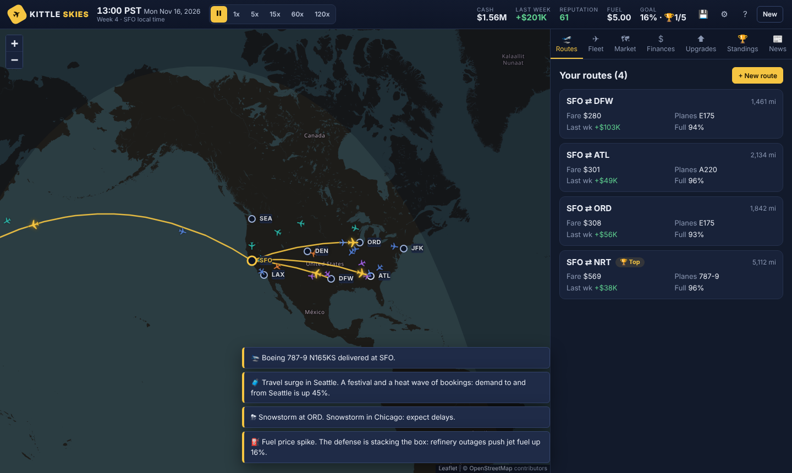

# Kittle Skies ✈

[](https://github.com/GeorgeKittle85/LukeGifford/actions/workflows/tests.yml)

**▶ Play now: <https://georgekittle85.github.io/LukeGifford/>**

**A real-ish-time airline tycoon for the browser.** You start with one leased
regional jet, one hub airport and $1,000,000. Open routes, set ticket prices,
lease bigger jets and grow without going bankrupt. Like building a dynasty
around one reliable tight end: start small, then expand once the foundation is
solid.



- 🌍 **Real world map.** Zoom from the whole globe down to real runways (OpenStreetMap). Live planes fly great-circle routes with day/night shading. A built-in outline map takes over when you're offline.
- ⏱ **Real-ish time.** At 1x, one real minute is 30 game minutes. Speed up to 120x, or pause any time. Every week settles like a turn, with a full report.
- 💸 **Realistic-ish economics.** Real aircraft (E175 to 787-9), 2026 lease rates and jet fuel prices, fares from a demand curve, four AI rival airlines.
- 💾 **Plays offline.** No server and no account. Autosaves in your browser, and you can export save files.

---

## Play it

Pick whichever is easiest:

| Option | How |
|---|---|
| **Online** | <https://georgekittle85.github.io/LukeGifford/> (GitHub Pages, deployed from `main`). The game caches itself, so after the first visit it works offline too. |
| **Local web server** | `npm start` (Node 20+, no install needed) and open <http://localhost:8000>. Or use `python3 -m http.server 8000`. |
| **Single offline file** | `npm install && npm run build:offline`, then double-click `dist/kittle-skies.html`. It's one ~1 MB file with everything inside, which you can copy anywhere. |

> Opening `index.html` straight from disk doesn't work, because browsers block
> JavaScript modules on `file://`. Use one of the options above. The page
> tells you this if you try.

## How to play

### Goal
- **Win** by reaching **$10M in cash**, or by being the **top airline on 5 routes**. Top means the most passengers that week, at least 1,000 of them, and at least 40% of everyone flying the route, including connecting travelers. After winning you can keep playing to grow the dynasty.
- **Lose** if your cash is below $0 at **two weekly settlements in a row**. You get one warning week.

### Time
- The clock runs continuously: **1x = 30 game minutes per real minute**, so a game day is 48 real minutes at 1x. Use **5x / 15x / 60x / 120x** to fast-forward; at 120x a week takes about 3 minutes.
- **Every Monday the week settles:** leases, overhead and hub costs are paid, reputation updates, rivals react, and you get a weekly report. The game can auto-pause for it (that's the default, and you can change it in Settings).
- You can change anything (routes, prices, planes) at any time, including while paused.

### Routes and prices
- The map has **10 airports**: SFO, LAX, SEA, DEN, DFW, ORD, ATL, JFK, plus London (LHR) and Tokyo (NRT). That's 45 possible routes. **Every route must start at one of your hubs.**
- Each route has a **distance**, a **demand level** (from a gravity model of city size, business and tourism) and a **competition level** (how many seats rivals fly).
- **Demand curve:** `passengers = baseDemand × (1 − fare / maxFare)`. That market is then shared between you, rival airlines and connecting carriers, based on fare, flights per week, reputation and loyalty. If you can't seat everyone, some of the overflow goes to whoever has empty seats.
- The fare slider shows a **live weekly estimate** of passengers, load factor, revenue, costs and profit. **"Use suggested fare"** picks the most profitable price for the planes on that route.

### Planes

| Aircraft | Seats | Range | Lease / month | Buy | Good for |
|---|---|---|---|---|---|
| Embraer E175 | 76 | 2,300 mi | $140K | $30M | your starter: thinner mid-length routes |
| Airbus A220-300 | 140 | 3,900 mi | $290K | $42M | efficient workhorse |
| Boeing 737-8 | 172 | 4,000 mi | $380K | $55M | busy domestic, short transatlantic |
| Airbus A321neo (LR) | 200 | 4,600 mi | $440K | $66M | busy routes, East Coast to London |
| Boeing 777-300ER (used) | 380 | 8,400 mi | $700K | $45M | huge long-haul markets (thirsty) |
| Boeing 787-9 | 300 | 8,700 mi | $1.15M | $150M | efficient long-haul flagship |

- An assigned plane shuttles back and forth automatically. **Departures run from 06:00 to midnight local time** at each airport, using real time zones and daylight saving time.
- **Leasing** needs a 2-month deposit and delivers in 2 days. **Returning** a lease refunds the deposit minus a 1-month fee. Buying ties up a lot of cash but has no lease payments.
- Wide-bodies have premium cabins that lift revenue per passenger (787 +16%, 777 +10%). They pay off only on big long-haul markets.

### Costs
Every flight pays for **fuel** (burn per hour × hours × the fuel price, which starts at **$4.40/gal**, about the Gulf Coast jet fuel price in October 2026), **crew**, **maintenance**, ground ops, **airport fees**, catering, and sales/distribution. Each week you also pay **leases**, overhead, extra hubs and the loyalty program.

### Reputation, events, upgrades
- **Reputation (0–100):** on-time flights help; delays, cancellations and bumped passengers (from overbooking) hurt. It drifts toward a target set by your service level, loyalty program and how fair your fares are. Low reputation means less demand.
- **Random events:** storms by season (snow at ORD, typhoons at NRT...), fuel spikes and drops, holiday rushes, economic slowdowns, conferences, a Big Game weekend, rival fare wars, plane breakdowns. Some events ask you to decide: union raises, charter offers, livery sponsorships, fuel hedges.
- **Upgrades:** extra hubs (up to 3) to unlock new routes, the Kittle Club loyalty program, ad campaigns. **Policies:** service level, maintenance budget, overbooking.

### Starting hubs
| Easier | Medium | Harder |
|---|---|---|
| ATL, LAX | SFO, ORD, SEA, DFW, JFK | DEN (Blitz Air's low-fare fortress) |

### Controls
- Mouse or touch for everything. Click airports and planes on the map for details and shortcuts.
- **Keyboard:** `Space` pause/resume · `1`–`5` speed · `R` routes · `F` fleet · `M` market · `$` finances · `U` upgrades · `V` standings · `N` news · `P` plan a route · `?` help.

## Development

```bash
npm test                  # engine unit tests (node:test, no dependencies)
npm run balance           # headless balance simulator: scripted strategies vs. the economy
npm start                 # local server on :8000
npm run build:offline     # dist/kittle-skies.html (needs `npm install` for esbuild)
npm run test:e2e          # browser smoke test (needs Playwright + Chromium installed)
npm run test:e2e -- --url=https://georgekittle85.github.io/LukeGifford/   # same test against the live site
```

**Continuous integration** (`.github/workflows/`):
- **Tests** runs on every push to `main`, every pull request, and on demand. It runs the engine unit tests on Node 20, 22 and 24, a short balance-simulator run, and the Chromium smoke test with the offline build. If a run fails, its screenshots are attached to the run.
- **Verify live site** runs after every GitHub Pages deployment (or on demand) and plays through the deployed game to make sure it actually works.

**Project layout**

```
index.html, sw.js, manifest.webmanifest    page shell, offline cache, install info
css/                                       dark "ops center" styles
src/engine/    pure, deterministic simulation (runs in the browser or Node)
src/data/      airports, aircraft, rival airlines, events, offline world map
src/host/      LocalHost: clock, commands, saves (swappable for an online host)
src/storage/   versioned save format + browser save slots
src/ui/        map (Leaflet), top bar, tabs, dialogs, charts
scripts/       local server, offline build, balance simulator
tests/         unit tests + Playwright smoke test
vendor/        Leaflet 1.9.4 (saved in the repo so the game works offline)
```

**Going online later?** The engine is pure and deterministic, every action
is a command object, and the UI talks to a swappable host. Cloud saves,
leaderboards or multiplayer can be added without rewriting the game. See
[ARCHITECTURE.md](ARCHITECTURE.md).

**Balancing.** `scripts/balance-sim.mjs` plays the game automatically with
three strategies. A sensible tycoon typically wins in roughly 25–35 game weeks
(longer from Denver), a passive one never wins, and a reckless one goes
bankrupt within weeks. Tuning knobs live in `src/engine/constants.js`.

## Credits

- Map data © [OpenStreetMap](https://www.openstreetmap.org/copyright) contributors; tiles from the OpenStreetMap Foundation, used under its [tile usage policy](https://operations.osmfoundation.org/policies/tiles/). Tiles are never cached offline.
- [Leaflet](https://leafletjs.com) 1.9.4 (BSD-2-Clause, see `vendor/leaflet/LICENSE`).
- Offline outline map: [Natural Earth](https://www.naturalearthdata.com/) via [world-atlas](https://github.com/topojson/world-atlas) (ISC, see `src/data/WORLD-ATLAS-LICENSE`).
- Economics references: Airlines for America cost data, DOT airfare reports, Airbus/Boeing specs, 2025–2026 aircraft value and lease estimates, EIA/Argus jet fuel prices (Oct 2026).

Kittle Skies is a fan-made game. It is not affiliated with or endorsed by
George Kittle, the San Francisco 49ers, the NFL, or any real airline. All rival
airlines are fictional.
